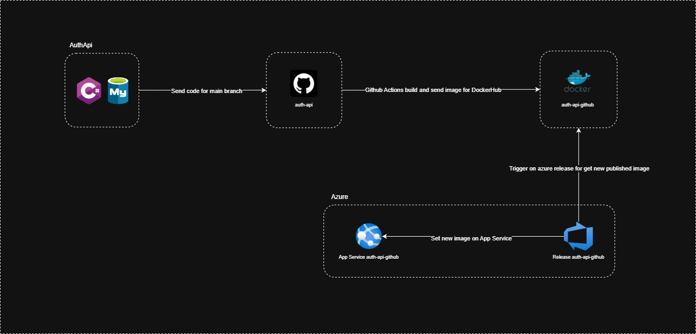

# Auth API

Auth API é uma API REST de autenticação e gerenciamento de usuários desenvolvida em .NET 8, construída com arquitetura Vertical Slice e hospedada na Azure. Este guia irá ajudá-lo a configurar e executar o projeto localmente ou com Docker.

## ☁️ Arquitetura na Cloud

A API Auth está hospedada na Azure App Service e segue um fluxo automatizado de CI/CD que garante atualizações contínuas sempre que houver mudanças no código.

### 📊 Fluxo de Deploy

O processo de deploy é totalmente automatizado e funciona da seguinte forma:

1. **GitHub Actions** - Quando código novo é enviado para a branch main no repositório, o workflow `.github/workflows/dotnet.yml` é acionado automaticamente
2. **Docker Hub** - O GitHub Actions faz o build da aplicação, cria uma imagem Docker e publica no Docker Hub com uma tag de versão incremental
3. **Azure DevOps** - O Azure DevOps está configurado para monitorar (trigger) o Docker Hub e, quando detecta uma nova imagem, automaticamente atualiza o serviço com a nova versão
3. **Azure App Service** - O Azure App Service é atualizado com a uma nova imagem automaticamente e atualiza a API com a nova versão

Esse fluxo garante que sempre que houver um push no repositório, a API na cloud seja atualizada automaticamente, sem necessidade de intervenção manual.

### 🌐 API na Azure

A API está disponível publicamente e pode ser acessada através do seguinte link:

**🔗 [https://auth-api-github.azurewebsites.net](https://auth-api-github-e2fchmhubhdsd4f9.brazilsouth-01.azurewebsites.net)**

> 💡 **Nota:** A API pode estar temporariamente indisponível caso o banco de dados ou o App Services esteja desligado. Para rodar a API localmente com banco de dados configurado, veja a seção [Execução Local](#-formas-de-execução) abaixo.

### 📐 Diagrama da Arquitetura



---

## 📋 Pré-requisitos para rodar a API localmente

Antes de começar, certifique-se de ter as seguintes ferramentas instaladas:

- [.NET 8 SDK](https://dotnet.microsoft.com/en-us/download/dotnet/8.0)
- [Docker Desktop](https://docs.docker.com/desktop/features/wsl/) (para execução com Docker)
- [Git](https://git-scm.com/downloads)

## 📥 Clonando o repositório

Após instalar todos os pré-requisitos, clone o repositório:

```bash
git clone https://github.com/diegoferreirax/auth-api.git
cd auth-api
```

## 🚀 Formas de execução

O projeto Auth API pode ser executado de duas formas:

### 1. Execução Local (sem Docker)

Ideal para desenvolvimento e depuração local. A aplicação roda localmente, mas o banco de dados MySQL é executado via Docker.

📖 **Guia completo:** [Executando Localmente](.doc/execucao-local.md)

### 2. Execução com Docker Compose

Ideal para simular um ambiente de produção e testes integrados. Tanto a aplicação quanto o banco de dados são executados em containers Docker.

📖 **Guia completo:** [Executando com Docker Compose](.doc/execucao-docker.md)

---

## ⚙️ Variáveis de Ambiente

O projeto suporta configuração através de variáveis de ambiente. As seguintes variáveis podem ser definidas:

| Variável                  | Descrição                                    | Exemplo (Local)                                    | Exemplo (Docker)                                    |
| ------------------------- | -------------------------------------------- | -------------------------------------------------- | --------------------------------------------------- |
| `AuthDbConnectionString`  | String de conexão com o banco de dados MySQL | `Server=localhost;Port=3306;Database=auth_db;Uid=auth_user;Pwd=root123;` | `Server=auth_mysql;Port=3306;Database=auth_db;Uid=auth_user;Pwd=root123;` |
| `JwtPrivateKey`           | Chave privada para geração de tokens JWT     | `fedaf7d8863b48e197b9287d492b708e`                | `fedaf7d8863b48e197b9287d492b708e`                  |
| `OTEL_SERVICE_NAME`       | Nome do serviço no OpenTelemetry            | `auth-api`                                         | `auth-api`                                          |
| `OTEL_EXPORTER_OTLP_PROTOCOL` | Protocolo do exportador OTLP            | `http/protobuf`                                    | `http/protobuf`                                     |
| `OTEL_EXPORTER_OTLP_ENDPOINT` | Endpoint do exportador OTLP             | `https://api.honeycomb.io`                         | `https://api.honeycomb.io`                          |
| `OTEL_EXPORTER_OTLP_HEADERS` | Headers do exportador OTLP              | `x-honeycomb-team=SeuTokenDoHoneyComb`             | `x-honeycomb-team=SeuTokenDoHoneyComb`              |

---

## 🧪 Testando a aplicação

Após iniciar a aplicação, você pode testá-la das seguintes formas:

### 1. Acessar o Swagger

Abra o navegador e acesse:

- **Local:** `http://localhost:5300/swagger`
- **Docker:** `http://localhost:5300/swagger`

### 2. Usar a collection do Postman

A collection do Postman está localizada na pasta `.doc/postman`. Ela contém todos os requests e payloads necessários para testar os endpoints da API.

### 3. Usar o JMeter

O projeto inclui um plano de testes configurado no JMeter para testes de carga e performance.

Para instruções detalhadas sobre como configurar e executar os testes com JMeter, consulte o [README do JMeter](.doc/jmeter/README.md).

---

## 🚀 Features

- Registros de usuário (create)
- Listagem de usuários com paginação (read)
- Exclusão de usuário (delete)
- Autenticação de usuário
- Criptografia de senha com BCrypt.Net
- Controle de acesso por função (Role-Based Access Control - RBAC) para alguns endpoints
- Utilização de Resource.resx para centralizar textos e mensagens em geral
- Uso do EF Core para facilitar e escalar a criação da estrutura da base de dados
- Monitoramento de logs com OpenTelemetry e Honeycomb

## 🔮 Features Futuras

- Utilização do banco MySql na Oracle
- Envio de código de confirmação de email

## 🧩 Patterns

- Arquitetura de `Vertical Slice` com Command, Handler e Endpoint separados para cada feature do dominio
- Versionamento das pastas e end-points de features para possíveis atualizações de escopo maior sem mudar a versão existente
- Projeto `AuthApi.Infraestructure` exclusivo para migrações do EF Core para separar a infraestrutura da base da regra de negócio
- Utilização da struct `Maybe` para tratamento de nullos
- Uso de `record` para objetos de request e response
- Criação de `UnitOfWork` no EF Core para centralizar as operações de mudanças
- Utilização de `primary constructor` nas classes que dependem de injeção de dependência

---

## 🔍 Troubleshooting

### Problemas comuns

**Erro ao iniciar o container:**
- Verifique se o Docker está rodando
- Verifique se as portas 5300 e 3306 não estão em uso
- Execute `docker compose down` antes de tentar novamente

**Erro de conexão com o banco:**
- Verifique se o container `auth_mysql` está rodando: `docker ps`
- Verifique se a connection string está correta
- Aguarde alguns segundos após iniciar o MySQL para garantir que está totalmente inicializado

**Erro com User Secrets no Windows:**
- Certifique-se de estar usando o arquivo `docker-compose_win.yml`
- Verifique se as secrets foram configuradas corretamente com `dotnet user-secrets list`

**Erro ao executar migrações:**
- Verifique se o banco de dados está acessível
- Verifique se a connection string está correta
- Certifique-se de estar no diretório correto (`src/AuthApi.Infraestructure`)
